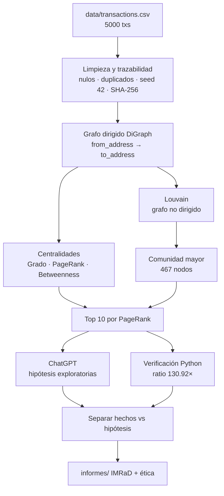
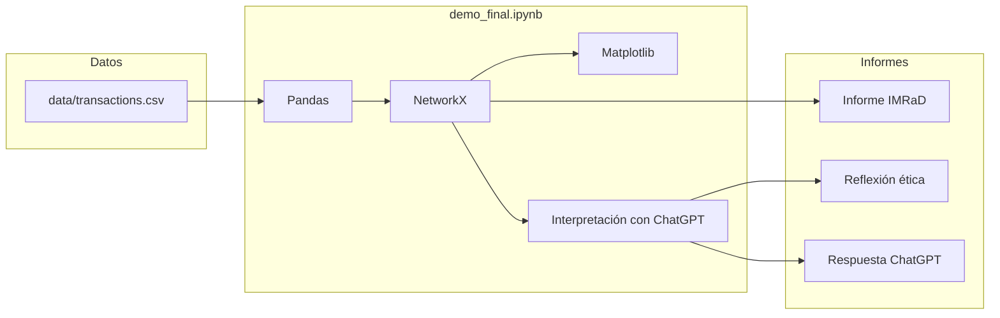
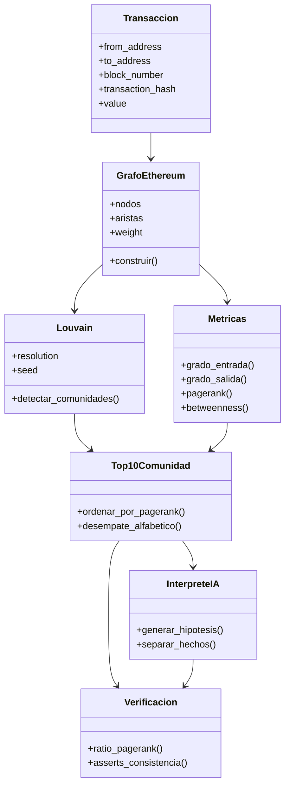

# Comunidades en Ethereum + interpretación crítica con IA

Análisis de una red de transacciones de Ethereum con **Louvain**, **PageRank** y evaluación crítica de hipótesis generadas con **ChatGPT**.

**Autores:** Giuliana Rolando · Claudio Cantero

> Objetivo: pasar de métricas de red a hipótesis interpretables, **sin confundir hipótesis con hechos**.

---

## Estructura del repositorio

```text
ethereum-comunidades-ia/
├── README.md
├── demo_final.ipynb          # Notebook principal (código + resultados)
├── data/
│   ├── README.md             # Descripción del dataset
│   └── transactions.csv      # Datos de transacciones Ethereum
└── informes/
    ├── README.md
    ├── Informe_IMRaD_Actividad3.pdf
    ├── Reflexion_Etica_Actividad3.pdf
    └── Respuesta_Original_ChatGPT.pdf
```

| Ruta | Qué contiene |
|------|----------------|
| `data/transactions.csv` | Dataset (origen, destino, bloque, hash, valor) |
| `demo_final.ipynb` | Pipeline completo de análisis |
| `informes/` | Informe IMRaD, reflexión ética y evidencia de ChatGPT |

---

## Dónde está la data y cómo se carga

La data vive en **`data/transactions.csv`**.

En el notebook:

```python
df = pd.read_csv("data/transactions.csv")
```

Columnas principales:

- `from_address` → origen (quién manda)
- `to_address` → destino (quién recibe)
- `block_number`, `transaction_hash`, `value`

Más detalle en [`data/README.md`](data/README.md).

**Integridad del dataset (SHA-256):**  
`712bb757578f5430f2d67b5f8d445a057041bf2c011c835a730df863599fc2ab`

---

## Flujo del proyecto



---

## Diagrama de componentes



---

## Modelo UML del pipeline



---

## Números clave

| Métrica | Valor |
|--------|------:|
| Transacciones originales | 5.000 |
| Transacciones usadas | 4.999 |
| Nodos | 5.620 |
| Aristas únicas | 4.601 |
| Comunidades Louvain | 1.188 |
| Comunidad mayor | 467 nodos |
| Ratio PageRank #1 / #2 | **130,92×** |
| Semilla | 42 |

---

## Configuraciones (y por qué)

| Técnica | Config | Motivo |
|---------|--------|--------|
| Grafo | `DiGraph` | Mandar ≠ recibir (`from` → `to`) |
| Peso de arista | nº de txs | Frecuencia de relación, no monto ETH |
| PageRank | `alpha=0.85` | Valor estándar / estable |
| PageRank | `weight=None` | Evitar premiar spam de repeticiones |
| Louvain | no dirigido | Densidad de conexión, no sentido de pago |
| Louvain | `resolution=1` | Default, sin forzar tamaños |
| Louvain | `seed=42` | Reproducibilidad |

---

## Cómo ejecutar

```bash
pip install pandas==3.0.5 networkx==3.6.1 matplotlib numpy==2.5.2 ipykernel
```

1. Clonar el repositorio  
2. Abrir la carpeta raíz del proyecto  
3. Verificar que exista `data/transactions.csv`  
4. Abrir `demo_final.ipynb`  
5. **Restart & Run All**  
6. Revisar informes en `informes/`

---

## Uso responsable de IA

ChatGPT se usó para formular hipótesis sobre el top 10, pidiendo separar hechos de conjeturas.  
La verificación cuantitativa (**130,92×**) se hizo en Python.  

**Estructura ≠ identidad.**  
No se afirmaron propietarios de direcciones sin evidencia externa (labels, tipo de cuenta, historial).

---

## Posibles mejoras

1. Etiquetas públicas verificadas (Etherscan) para el top 10  
2. Sensibilidad de parámetros (PageRank con/sin pesos, otras resoluciones)  
3. Historial más amplio y clasificación contrato vs wallet  
4. Protocolo de verificación para cada afirmación numérica de la IA  

---

## Autores

Proyecto académico de Big Data — demo integradora con IA.

- **Giuliana Rolando**
- **Claudio Cantero**
