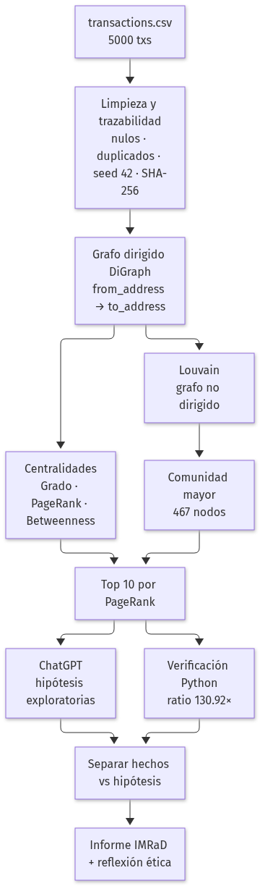

# Comunidades en Ethereum + interpretación crítica con IA

[](https://www.python.org/)
[](https://networkx.org/)
[](#)
[](https://github.com/Claudio1993cg/ethereum-comunidades-ia)

Análisis de una red de transacciones de Ethereum con **Louvain**, **PageRank** y evaluación crítica de hipótesis generadas con **ChatGPT**.

**Autores:** Giuliana Rolando · Claudio Cantero

> Objetivo: pasar de métricas de red a hipótesis interpretables, **sin confundir hipótesis con hechos**.

---

## Resultados visuales

### 1) PageRank del top 10 (comunidad más grande)

La dirección líder concentra una importancia estructural claramente superior. La verificación en Python confirma un ratio de **130,92×** frente al segundo nodo.


### 2) Comunidades detectadas con Louvain

Mapa de la red coloreando las 5 comunidades más grandes. El resto se muestra en gris para legibilidad.


---

## Flujo del proyecto

Del dataset a la verificación crítica de la IA:



---

## Diagrama de componentes

Cómo se conectan datos, notebook y salidas:


---

## Modelo UML del pipeline

Clases conceptuales del análisis (datos → grafo → métricas → IA → verificación):


---

## Secuencia: de datos a verificación

Interacción entre dataset, NetworkX, ChatGPT y Python:


---

## Números clave

| Métrica | Valor |
|--------|------:|
| Transacciones originales | 5.000 |
| Transacciones usadas | 4.999 |
| Nodos | 5.620 |
| Aristas únicas | 4.601 |
| Comunidades Louvain | 1.188 |
| Comunidad mayor | 467 nodos |
| Ratio PageRank #1 / #2 | **130,92×** |
| Semilla | 42 |

**SHA-256** de `transactions.csv`:  
`712bb757578f5430f2d67b5f8d445a057041bf2c011c835a730df863599fc2ab`

---

## Configuraciones (y por qué)

| Técnica | Config | Motivo |
|---------|--------|--------|
| Grafo | `DiGraph` | Mandar ≠ recibir (`from` → `to`) |
| Peso de arista | nº de txs | Frecuencia de relación, no monto ETH |
| PageRank | `alpha=0.85` | Valor estándar / estable |
| PageRank | `weight=None` | Evitar premiar spam de repeticiones |
| Louvain | no dirigido | Densidad de conexión, no sentido de pago |
| Louvain | `resolution=1` | Default, sin forzar tamaños |
| Louvain | `seed=42` | Reproducibilidad |

---

## Stack e instalación

```bash
pip install pandas==3.0.5 networkx==3.6.1 matplotlib numpy==2.5.2 ipykernel
```

1. Clonar el repo  
2. Abrir `demo_final.ipynb`  
3. Verificar que `transactions.csv` esté en la misma carpeta  
4. **Restart & Run All**

---

## Archivos del repositorio

| Archivo | Descripción |
|---------|-------------|
| `demo_final.ipynb` | Notebook completo con código y salidas |
| `transactions.csv` | Dataset de transacciones |
| `docs/images/` | Figuras de resultados para el README |
| `Informe_IMRaD_Actividad3.pdf` | Informe académico |
| `Reflexion_Etica_Actividad3.pdf` | Uso responsable de IA |
| `Respuesta_Original_ChatGPT.pdf` | Evidencia de la interacción con IA |

---

## Uso responsable de IA

ChatGPT se usó para formular hipótesis sobre el top 10, pidiendo separar hechos de conjeturas.  
La verificación cuantitativa (**130,92×**) se hizo en Python.  

**Estructura ≠ identidad.**  
No se afirmaron propietarios de direcciones sin evidencia externa (labels, tipo de cuenta, historial).

---

## Posibles mejoras

1. Etiquetas públicas verificadas (Etherscan) para el top 10  
2. Sensibilidad de parámetros (PageRank con/sin pesos, otras resoluciones)  
3. Historial más amplio y clasificación contrato vs wallet  
4. Protocolo de verificación para cada afirmación numérica de la IA  

---

## Autores

Proyecto académico de Big Data — demo integradora con IA.

- **Giuliana Rolando**
- **Claudio Cantero**

Repo: [Claudio1993cg/ethereum-comunidades-ia](https://github.com/Claudio1993cg/ethereum-comunidades-ia)
